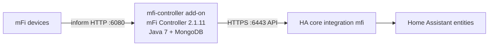
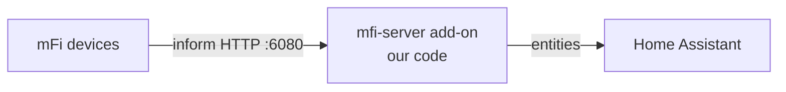

# Architecture

## Goal

Use 50+ working Ubiquiti mFi devices from Home Assistant OS (amd64), locally.
Every outlet, power reading and sensor becomes a Home Assistant entity.

## Phase 1 - original controller in a container

- The add-on image is built locally by the Home Assistant Supervisor from the
  `Dockerfile` (no prebuilt image, no CI needed).
- The `Dockerfile` downloads `mFi.unix.zip` 2.1.11 from `dl.ubnt.com` and checks
  the pinned sha256 (see AGENTS.md).
- Persistent data (`<mFi>/data`, MongoDB files) lives in the add-on `/data` volume.
- Pros: works without understanding the protocol; a running controller lets us
  capture real device traffic for phase 2.
- Cons: 2015 software, Java 7 and an old MongoDB, no security updates; a second
  web UI next to Home Assistant.

## Phase 2 - our own server

- Speaks the inform protocol directly (see `docs/PROTOCOL.md`).
- No vendor code. Reuse is allowed from MIT/Apache projects, with credit
  (`uilibs/mficlient` MIT, `magcode/mpower-tools` Apache-2.0,
  `pasbec/home-assistant-mfi-mpower` MIT).
- Based on the inform specification in `docs/PROTOCOL.md`, taken from the decompiled controller
  2.1.11; the questions that need a real device are listed there.

## Decisions

| Date | Decision |
|---|---|
| 2026-11-15 | Target is a Home Assistant add-on repository, private for now |
| 2026-11-15 | Two phases: original controller first, own server second |
| 2026-11-15 | No vendor files in the repository; download at build time with sha256 |
| 2026-11-15 | Repository files in English; offline stdlib tests |
| 2026-11-15 | mfi-server uses the Python standard library only (own AES-128 and BSON reader) |
| 2026-11-15 | mfi-server is a full controller: the same code runs as a Home Assistant add-on and as a standalone program |
| 2026-11-15 | Home Assistant entities come through MQTT discovery; the server exposes its data over MQTT by default, and MQTT is optional when no broker is configured |
| 2026-11-15 | Web API: measurement history in sqlite3 for 30 days; standalone login with a salted PBKDF2 password hash; add-on access only through the Home Assistant ingress |

## Existing work (checked 2026-11-15)

No Home Assistant add-on for mFi exists on GitHub. Old controller images exist
on Docker Hub (`fflo/mfi-controller` last updated 2021-12-13, `jacekkow/mfi`
2018-05-13, source `jacekkow/docker-mfi`). Nothing covers mPort and sensors
without the original controller.
