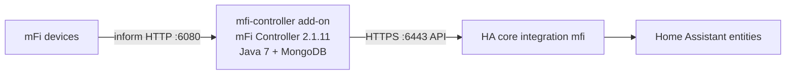
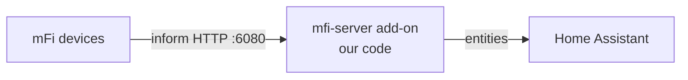

# Architecture

## Goal

Use 50+ working Ubiquiti mFi devices from Home Assistant OS (amd64), locally.
Every outlet, power reading and sensor becomes a Home Assistant entity.

## Phase 1 - original controller in a container

- The add-on image is built locally by the Home Assistant Supervisor from the
  `Dockerfile` (no prebuilt image, no CI needed).
- The `Dockerfile` downloads `mFi.unix.zip` 2.1.11 from `dl.ubnt.com` and checks
  the pinned sha256 (see AGENTS.md).
- Persistent data (`<mFi>/data`, MongoDB files) lives in the add-on `/data` volume.
- Pros: works without understanding the protocol; a running controller lets us
  capture real device traffic for phase 2.
- Cons: 2015 software, Java 7 and an old MongoDB, no security updates; a second
  web UI next to Home Assistant.

## Phase 2 - our own server

- Speaks the inform protocol directly (see `docs/PROTOCOL.md`).
- No vendor code. Reuse is allowed from MIT/Apache projects, with credit
  (`uilibs/mficlient` MIT, `magcode/mpower-tools` Apache-2.0,
  `pasbec/home-assistant-mfi-mpower` MIT).
- Based on the inform specification in `docs/PROTOCOL.md`, taken from the decompiled controller
  2.1.11; the questions that need a real device are listed there.

## Wi-Fi setup helper (Windows)

Wi-Fi devices without a Wi-Fi configuration serve their setup page only at
`https://192.168.2.20` over TLS 1.0, which current browsers refuse.
`mfi-wifi-setup/` is a Windows program that bridges the user's browser to that
page (`docs/WIFI-SETUP.md`). Wired devices do not need it.

## Decisions

| Date | Decision |
|---|---|
| 2026-11-15 | Target is a Home Assistant add-on repository, private for now |
| 2026-11-15 | Two phases: original controller first, own server second |
| 2026-11-15 | No vendor files in the repository; download at build time with sha256 |
| 2026-11-15 | Repository files in English; offline stdlib tests |
| 2026-11-15 | mfi-server uses the Python standard library only (own AES-128 and BSON reader) |
| 2026-11-15 | mfi-server is a full controller: the same code runs as a Home Assistant add-on and as a standalone program |
| 2026-11-15 | Home Assistant entities come through MQTT discovery; the server exposes its data over MQTT by default, and MQTT is optional when no broker is configured |
| 2026-11-15 | Web API: measurement history in sqlite3 for 30 days; standalone login with a salted PBKDF2 password hash; add-on access only through the Home Assistant ingress |
| 2026-11-16 | Automations use the Home Assistant format; the engine is our own code, written clean room (no Home Assistant code copied) |
| 2026-11-16 | Repository published on GitHub (public, existing history kept); standard install from the add-on store |
| 2026-11-17 | First setup of Wi-Fi devices through a Windows program (`mfi-wifi-setup/`, one `.exe`, nothing installed), not a browser extension: an extension cannot add TLS 1.0 to Chrome |
| 2026-11-18 | Full rewrite: feature parity with the 2.1.11 controller, Home Assistant style, whole repository; plan in docs/REBUILD-PLAN.md |
| 2026-11-19 | Risky network functions (web shell, SSH from the browser, UPnP announcements, guest page) are implemented but off by default, each behind its own setting, with a risk warning in `mfi-server/DOCS.md` (owner decision) |
| 2026-11-19 | The web shell and SSH from the browser take the target address only from the stored device record, never from the request; the web shell accepts only adopted mPort Serial devices |
| 2026-11-20 | The mFi Server add-on (1.0.0) runs the new package `mfi_server_next`; the previous package `mfi_server` stays in the repository, not started, until the next epic removes it. Way back: change the `CMD` of `mfi-server/Dockerfile` to `mfi_server` and release a patch |

## Existing work (checked 2026-11-15)

No Home Assistant add-on for mFi exists on GitHub. Old controller images exist
on Docker Hub (`fflo/mfi-controller` last updated 2021-12-13, `jacekkow/mfi`
2018-05-13, source `jacekkow/docker-mfi`). Nothing covers mPort and sensors
without the original controller.
