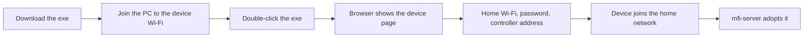
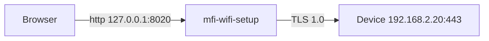

# mFi Wi-Fi Setup - specification of the Windows helper

Version 0.3.0 - 2026-11-17. Status: specification and verified prototype. The
Windows program is not built yet.

Changes: 0.3.0 - the version 2 window (guided setup) is implemented: the Wi-Fi
network is chosen in the program, progress follows `status.cgi`. 0.2.0 - the
program is a graphical window (GUI) with numbered steps; name of the device
access point measured. 0.1.0 - first version.

## Why

Wi-Fi mFi devices without a Wi-Fi configuration (new, or after a factory reset)
run their own access point. Their setup page is always at
`https://192.168.2.20`, the same address on every device. The device speaks
TLS 1.0 only (measured, see `docs/PROTOCOL.md`, "Wi-Fi setup mode"). Current
browsers removed TLS 1.0: Chrome shows `ERR_SSL_VERSION_OR_CIPHER_MISMATCH`
and offers no way to continue, and plain `http://192.168.2.20` does not help
(both observed on 2026-11-17, Chrome on Android). Without that page a Wi-Fi
device cannot join the home network, so mfi-server never sees it.

Which devices (official Quick Start Guides):

| Device | Setup after a factory reset | Needs this program |
|---|---|---|
| mPower, mPower mini (US, EU) | own access point, page at `https://192.168.2.20` | yes |
| In-wall outlet MPW, MPW-W; in-wall switch LD, LD-W | own access point, page at `https://192.168.2.20` | yes |
| mPort, mPort Serial | Ethernet: computer with a static address on `192.168.1.x` and page at `http://192.168.1.20`, or DHCP on the LAN | no for adoption (mfi-server adopts wired devices over SSH); optional for its page |

Whether the mPort page is also TLS 1.0 only: UNVERIFIED (INFERRED likely: one
firmware family for all mFi products, AGENTS.md). If it is, the same program
opens it with `--map 8020=192.168.1.20`.

## What the user does



## Requirements

| ID | Requirement |
|---|---|
| R1 | One file for Windows 10 and 11, 64-bit. Download and run: no installation, no administrator rights, no change to browser or system settings. |
| R2 | Works with the browser the user already has (default browser). |
| R3 | TLS 1.0 and weak ciphers only towards the device. The program listens on 127.0.0.1 only. |
| R4 | Wi-Fi passwords and controller credentials never reach disk or logs. The device page sends them in the query string of `/captive.cgi`. |
| R5 | Messages in Italian and English, chosen from the Windows language, English as fallback. |
| R6 | Clear messages for: PC not joined to the device Wi-Fi (`192.168.2.20` not reachable), device not answering, page ready, how to stop. |
| R7 | Source in this repository. The built `.exe` is never committed (AGENTS.md rule 1); it is published as a release asset with its sha256. |
| R8 | Tests run offline with the standard library (AGENTS.md rule 4). |
| R9 | A graphical window, no console: the user reads numbered steps and presses buttons; nothing is typed on a command line. |

## Window (GUI)

The program is a small window built with `tkinter` (Python standard library,
included in the PyInstaller build), started without a console window.

Version 1 window, bridge to the original page:

```text
+------------------------------------------------------+
| mFi Wi-Fi Setup                          [IT] [EN]   |
|                                                      |
| 1  Join this PC to the Wi-Fi of the device:          |
|    open network "mFi XXXXXX", no password            |
|    Status: device found - mPower mini, v2.1.11       |
|                                                      |
| 2  [ Open the device page ]                          |
|                                                      |
| 3  In the page: choose your home Wi-Fi, type its     |
|    password and this controller address:             |
|    [ <Home Assistant address>:6080 ]  [ Copy ]       |
|                                                      |
|                                        [ Close ]     |
+------------------------------------------------------+
```

- The access point of the device is an open network named `mFi` plus the last
  6 hex digits of the MAC address (MEASURED, `docs/PROTOCOL.md`).
- Step 1 checks the device every 2 s (`GET /status.cgi` over TLS 1.0) and
  shows the model from `host.hostname` and the firmware from `host.fwversion`.
  Until the device answers, step 2 is disabled and the window says why: PC not
  on the device Wi-Fi, or device not answering.
- The program may read the current Wi-Fi name with `netsh wlan show interfaces`
  (no administrator rights) to say "you are on mFi XXXXXX". It never creates or
  changes Wi-Fi profiles (R1).
- Step 2 starts the bridge and opens the default browser on it.
- Step 3: the controller address is remembered between runs (it is not a
  secret). Passwords are never stored.
- Closing the window stops the bridge.

Version 2 window, guided setup (ticket W4, done; device test pending): the same
step 1, then, in the program itself:

- a list of the visible networks from `survey.json.cgi`, strongest signal first.
  Only open networks and WPA/WPA2 personal networks are listed; WEP and EAP
  (enterprise) networks are not shown.
- a password field, hidden, with a "show" option; no password for open networks.
- a `Configure` button: the program sends the chosen network and password to
  `captive.cgi`, and nothing else (no controller address, no `cloud_name`, no
  `cloud_pass`).
- a progress line driven by `status.cgi` every 1 s: waiting, Wi-Fi connected,
  address obtained, or error (`wifitimeout`, `iptimeout`, or timeout).
- on success: "Device on your network at <ip>" and the advice to open mfi-server,
  which adopts the device. The program does not change the controller fields of
  the device: they are not shown in the window and not sent.

The password is never written to disk or to the log.

## Design

### Version 1 - bridge to the original page (prototype verified)



- Starts a local HTTP server on `127.0.0.1:8020` and opens the default browser
  on it. The user works on the original device page.
- Towards the device: minimum TLS 1.0, OpenSSL ciphers `ALL:@SECLEVEL=0`,
  certificate not verified (self-signed and expired).
- Rewrites, so the browser stays on the program: `Location` header, absolute
  links to the device in text responses, `Origin` and `Referer` towards the
  device, `Secure` flag removed from cookies, `Strict-Transport-Security`
  dropped, `Accept-Encoding: identity` towards the device.
- The log never contains query strings.
- If port 8020 is busy, use the next free port (the prototype stops with an
  error instead).

Prototype: `mfi-wifi-setup/prototype/legacy_tls_proxy.py`. Verified on
2026-11-17 against an mPower mini with firmware v2.1.11, from a Windows PC
joined to the device access point, Python 3.13.14 with OpenSSL 3.0.21:

| Check | Result |
|---|---|
| `GET /` through the proxy | HTTP 200, setup page 36,535 bytes, cookie `AIROS_SESSIONID` |
| Absolute links to the device left in the page | 0 |
| `GET /captivepoll.cgi`, `/status.cgi`, `/survey.json.cgi` | HTTP 200, JSON of 46, 1,577 and 5,718 bytes |
| Request with a fake `wpa_key` in the query string | value found 0 times in the log; the log shows `?<hidden>` |
| Apply (`/captive.cgi`), switch to the home network | NOT verified |

Open points of version 1 (need the device test, ticket W3):

1. After Apply the page polls `ping.cgi` on the new device address with the
   page's own protocol (through the program: `http://<new address>/ping.cgi`),
   then opens `http://<new address>`. Whether this works: UNVERIFIED.
2. Whether Windows rejoins the home Wi-Fi by itself when the device closes its
   access point: UNVERIFIED.

### Version 2 - guided setup (implemented, ticket W4; device test pending)

The program is a window (`tkinter`) and talks to the device endpoints itself;
the user never sees the device UI. The six steps are DONE (DevAgentAi, ticket
W4, core in `mfi-wifi-setup/mfi_wifi_setup/`); the device test is still open
(ticket W3, a person):

1. DONE. `GET /captivepoll.cgi`: device found. Show the model (`status.cgi`
   `host.hostname`) and the firmware (`host.fwversion`).
2. DONE. `GET /survey.json.cgi`: list of visible networks (`essid`,
   `signal_level`, `encryption`). Only open and WPA/WPA2 personal networks are
   listed; WEP and EAP are not (`is_supported` in `wifi_survey.py`).
3. DONE. The user picks the network and types the password in the program. The
   controller address is NOT asked for and NOT prefilled: the step planned in the
   first draft (prefill `host:6080`) is not implemented. The controller fields
   `inform_addr`, `cloud_name` and `cloud_pass` are not sent, and the program does
   not change them: mfi-server adopts the device later, over SSH (`docs/PROTOCOL.md`,
   "Adoption"). So version 2 has no controller address field.
4. DONE. `GET /captive.cgi?<fields>` with only `type=POST`, `essid`, `security`
   and, for WPA/WPA2, `wpa_auth=WPA-PSK` and `wpa_key` (not the other form
   fields). Field names and values: `docs/PROTOCOL.md`, "Wi-Fi setup mode".
5. DONE. Progress from `GET /status.cgi` every 1 s (`host.cp_state`,
   `wireless.essid`, `wireless.apmac`, `wlan.ip`). Wi-Fi connected = essid set and
   apmac not all zeros; address obtained = that, and `wlan.ip` not `0.0.0.0`;
   `wifitimeout` or `iptimeout` = error. Version 2 does not use `host.ctrl_state`.
   Field meanings: `docs/PROTOCOL.md`, "Wi-Fi setup mode".
6. DONE. `POST /leaveap.cgi` only when the address is obtained; then the window
   shows `Device on your network at <ip>` and the advice to open mfi-server. On
   error or timeout the access point is not closed.

Version 2 is implemented from the endpoints and fields seen on the device
(`docs/PROTOCOL.md`, "Wi-Fi setup mode"); no command is invented. Still open,
to be checked by the device test (ticket W3, a person):

- The mapping `encryption` -> `security` (text containing `wpa2` -> `wpa2`,
  containing `wpa` -> `wpa`, else `none`) and the choice of the `security` value
  sent for WPA/WPA2-PSK: INFERRED from the survey text and the form values;
  UNVERIFIED, not tested on a device.
- The split of `auth_suites` into PSK and EAP by text: UNVERIFIED.
- The device behaviour after `leaveap.cgi` on the home network: UNVERIFIED (open
  points 1 and 2 of version 1, questions 15 to 17 of `docs/PROTOCOL.md`).
- The device test itself: a person runs the checklist under "Tests" and writes
  the results in this file.

## Technology

| Option | TLS 1.0 to the device | Build | Status |
|---|---|---|---|
| Python standard library + PyInstaller one-file `.exe` | works (prototype) | needs Windows: PyInstaller does not cross-compile | prototype verified; `.exe` UNVERIFIED |
| Python embeddable package (zip) + launcher | same OpenSSL family as the prototype | can be assembled on Linux | UNVERIFIED |
| Go single binary | Go `crypto/tls` has no DHE suites; the RSA key exchange suites `AES128-SHA` and `AES256-SHA` (accepted by the device) and TLS 1.0 must be enabled explicitly | cross-compiles to Windows from Linux | UNVERIFIED: test on a device first |
| .NET | Windows Schannel, whose TLS 1.0 support depends on the Windows version and policy | Windows | rejected: depends on the system |
| Browser extension | an extension cannot add TLS 1.0 to Chrome: extension APIs act on HTTP requests, after TLS | - | rejected |

Choice for version 1: Python standard library, packaged with PyInstaller as one
`.exe`, built on Windows by a human with a script from this folder. DevAgentAi
writes the code, the tests and the build script; a human runs the build and
the device test.

Window: `tkinter`, a thin layer over a core module (bridge, device check,
messages). The core holds all the logic and is tested offline; the tests never
import `tkinter`, because the test container may not have it.

Known risks, UNVERIFIED: Windows SmartScreen warns about an unsigned `.exe`;
some antivirus programs flag PyInstaller one-file executables.

## Tests

Offline (DevAgentAi, Linux, standard library):

- Pure functions with samples: `rewrite_location`, `rewrite_body`,
  `rewrite_cookie`, `rewrite_request_origin`, `hide_query`, `parse_map`.
- Request flow against a fake device: make the upstream connection
  injectable, run a plain-HTTP fake device on 127.0.0.1 (no TLS certificate
  needed), and check status, headers, rewritten body, and that query strings
  never reach the log.
- Messages: every message key exists in Italian and in English.
- Device check: state from a fake `status.cgi` (found, not found, not
  answering), model and firmware read from `host.hostname` and
  `host.fwversion`.

On Windows with a device in setup mode (human, ticket W3). Write the results
in this file:

1. Build the `.exe`; record its size and sha256.
2. Join the PC to the device Wi-Fi; run the `.exe`; the browser shows the
   device page.
3. Choose the home network and Apply; record what the page shows and the
   `status.cgi` states.
4. Check that the device appears in the mfi-server discovery list.
5. Check the log: no password.
6. Optional: an mPort on Ethernet at `192.168.1.20`; record whether its page is
   TLS 1.0 only.

## Distribution

- GitHub release asset `mfi-wifi-setup-<version>-windows-x64.exe` plus its
  sha256.
- The mfi-server page shows a box "New Wi-Fi device? Download mFi Wi-Fi Setup"
  with the link (ticket W5).

## Tickets proposed for DevAgentAi

| Ticket | Scope | Who runs it |
|---|---|---|
| W1 | Program in `mfi-wifi-setup/` from the prototype: core module (bridge, device check, Italian and English messages, next free port) and the version 1 window; offline tests of the core; test command added to the CI workflow | DevAgentAi |
| W2 | Windows build script `mfi-wifi-setup/build_windows.cmd` (temporary venv, PyInstaller one-file, sha256 of the output) and its README section | DevAgentAi writes, a human runs |
| W3 | Device test of the `.exe` (checklist above) and answers to the open points | human |
| W4 | Version 2 window, guided setup (done) | DevAgentAi, only after W3 |
| W5 | mfi-server page: download box for Wi-Fi devices | DevAgentAi |
